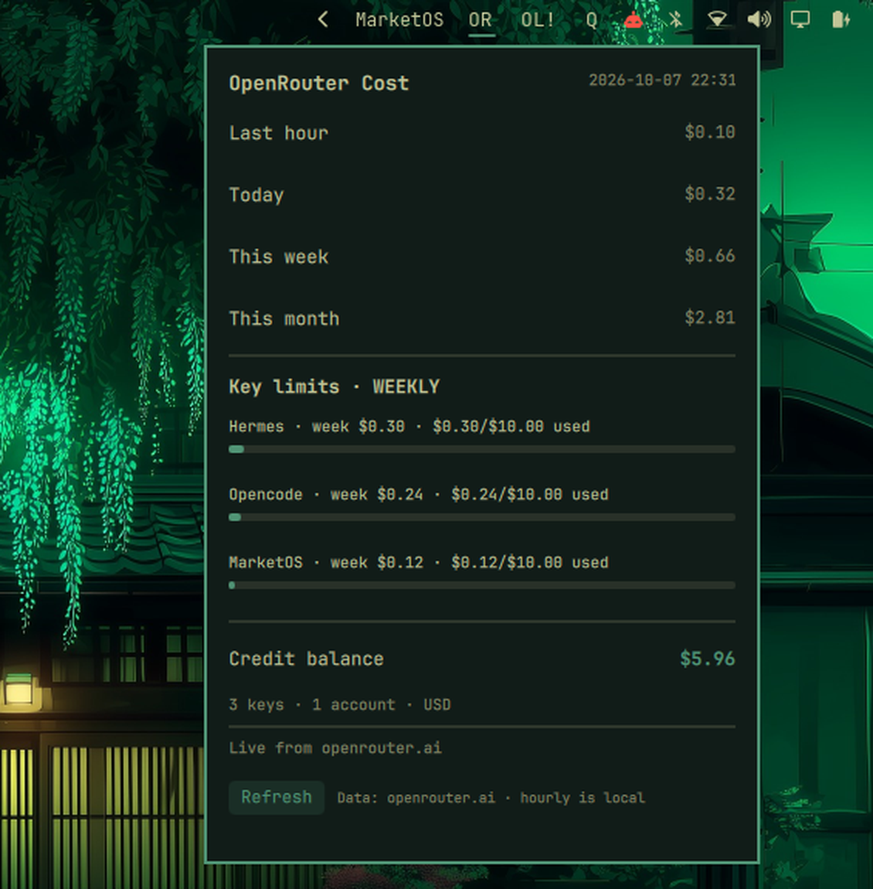

# OpenRouter API Cost — Omarchy bar widget

A live [OpenRouter](https://openrouter.ai) spend tracker for the Omarchy
status bar. The bar shows the OpenRouter icon; clicking it opens a dropdown
with your spend for the **last hour**, **today**, **this week** and
**this month**, plus **per-key limits** and your **credit balance**.



Tested on Omarchy 4.0.6; 4.5-ready.

## Features

- Bar icon:
  - the OpenRouter mark, in your bar's text colour — working, data is current
  - `⚠` — no API key configured
  - `!` — the last fetch failed (details in the dropdown)
- Dropdown: spend for the last hour, today, this week and this month
- Per-key limits for up to 3 keys: name, this week's spend and used/limit,
  with a progress bar. Each OpenRouter key has its own limit and reset
  period; the section header shows the first key's reset period.
- Credit balance (needs a Management key, see below)
- Aggregates spend across multiple API keys / accounts
- Auto-refreshes every 5 minutes, on click, and from a Refresh button

Not shown yet: the all-time (lifetime) spend is collected in
`overview.json` but isn't displayed in the dropdown.

## Which key to use

**Use one Management key.** Create it at
[openrouter.ai/settings/management-keys](https://openrouter.ai/settings/management-keys)
and the widget lists every API key on your account by itself, with each
key's spend and limit, plus your credit balance. You don't need to paste your
app keys one by one, and new keys show up on the next refresh. Management keys
can't be used for model calls, so it's only for tracking. It can manage your
other keys, though, so keep it private (the installer saves it with mode 600)
and give it an expiry date.

**A normal API key works too**, but the widget then tracks only the key(s)
you configure. OpenRouter's `/api/v1/credits` endpoint may return 403 for a
normal key; then the credit balance and last-hour figures show `—` and the
all-time figure is empty. Today, this week, this month and the per-key limits
still work.

Both kinds start with `sk-or-v1-`, so the widget tells them apart by asking
OpenRouter. The installer's check says which kind you pasted.

## Requirements

- Omarchy (Quickshell-based shell with QML plugin support)
- An OpenRouter [Management key](https://openrouter.ai/settings/management-keys)
  (recommended) or a normal [API key](https://openrouter.ai/settings/keys)
- Python 3 (only for the `update.py` data fetcher; standard library only)

## Installation

```bash
curl -fsSL https://raw.githubusercontent.com/neilmc81/omarchy-openrouter-cost/main/install.sh | bash
```

The installer:

- clones the plugin to `~/.config/omarchy/plugins/openrouter.cost` (or runs
  `git pull --ff-only` if it's already a clone; a symlink or any other
  existing folder is left alone)
- asks you to paste your OpenRouter Management key (hidden input, Enter
  skips; a normal API key also works) and saves it to
  `~/.config/openrouter-cost/key` with mode 600. If `OPENROUTER_API_KEY` is
  set, that key is saved instead of asking. Nothing is asked or changed if a
  key is already configured, and there's no prompt without a terminal or with
  `--no-prompt`. A key that doesn't start with `sk-or-` gets a warning but is
  still saved. If you skip, it prints how to add one later and the bar shows
  `⚠` until you do.
- backs up `~/.config/omarchy/shell.json` to `shell.json.bak-<timestamp>` and
  adds `{ "id": "openrouter.cost" }` to the bar's right side, unless it's
  already there
- fetches your data once to check the key (and says whether it's a
  Management key or a normal one), then runs `omarchy restart shell`

Options go after `bash -s --`, e.g. `... | bash -s -- --no-restart`:

| Option / env                    | Effect                                        |
|---------------------------------|-----------------------------------------------|
| `--no-prompt`, `OPENROUTER_COST_NO_PROMPT=1` | don't ask for a key              |
| `--no-register`                 | don't edit `shell.json`; print the snippet    |
| `--no-verify`                   | don't fetch your data to check the key        |
| `--no-restart`, `OPENROUTER_COST_NO_RESTART=1` | don't restart the shell        |
| `OMARCHY_PLUGINS_DIR`           | plugins directory (default `~/.config/omarchy/plugins`) |
| `OPENROUTER_COST_REPO` / `OPENROUTER_COST_REF` | clone source and branch/tag (default this repo, `main`) |

### Manual install

The plugin folder **must be named `openrouter.cost`** (it matches the plugin
id in `manifest.json`).

```bash
# 1. Clone the plugin into your Omarchy plugins directory
git clone https://github.com/neilmc81/omarchy-openrouter-cost \
    ~/.config/omarchy/plugins/openrouter.cost

# 2. Add your Management key (or a normal API key; see "Which key to use"), e.g.
mkdir -p ~/.config/openrouter-cost
printf '%s\n' 'sk-or-v1-...' > ~/.config/openrouter-cost/key
chmod 600 ~/.config/openrouter-cost/key

# 3. Register the widget in ~/.config/omarchy/shell.json under "bar",
#    e.g. in "layout" → "right":
#      { "id": "openrouter.cost" }
#    then reload the shell:
omarchy restart shell
```

## Uninstall

```bash
curl -fsSL https://raw.githubusercontent.com/neilmc81/omarchy-openrouter-cost/main/uninstall.sh | bash
```

This removes the widget from `shell.json` (after a backup), the plugin folder
(only if it's an unmodified git clone of this repo; symlinks are left alone),
and the cached data in `~/.local/state/openrouter-cost`, then restarts the
shell. It asks before deleting your keys in `~/.config/openrouter-cost`; the
default is to keep them. `--yes` skips the question and keeps the keys;
`--purge` deletes them. `--no-restart` works as for the installer.

## Configuration

Keys are collected from all of these sources (duplicates are ignored). If one
of them is a working Management key, the widget shows every key on the account
from that and ignores the others, so nothing is counted twice:

| Source                                   | Format                                   |
|------------------------------------------|------------------------------------------|
| `$OPENROUTER_API_KEY`                    | one key                                  |
| `$OPENROUTER_KEY`                        | one key                                  |
| `~/.config/openrouter-cost/conf.json`    | `{"api_key": "sk-or-..."}` or `{"api_keys": ["sk-or-...", "sk-or-..."]}` |
| `~/.config/openrouter-cost/key`          | one key on a single line                 |

With a Management key, each key is shown with the name you gave it on
OpenRouter. With normal keys, in `conf.json` you can name your keys with an optional `names` array, in the
same order as the keys:

```json
{
  "api_keys": ["sk-or-...", "sk-or-..."],
  "names": ["Personal", "Work"]
}
```

`names` are matched by position across all keys found, including env vars; if
you mix `OPENROUTER_API_KEY` with `conf.json`, put all keys in `conf.json`.

Unnamed keys are shown as `Key 1`, `Key 2` and so on. Changes are picked up on
the next refresh (no shell restart needed).

## Security

- Keys are read only from the environment variables and files listed above,
  and are sent only to `openrouter.ai`.
- No part of a key is printed, logged, or written to `overview.json` or
  `history.jsonl`.
- The widget does **not** check file permissions. Protect your key files
  yourself:

  ```bash
  chmod 600 ~/.config/openrouter-cost/key ~/.config/openrouter-cost/conf.json
  ```

## Data source

The widget uses OpenRouter's own accounting endpoints:

- `GET /api/v1/keys` (Management key) — every enabled key on the account
  with the same usage and limit fields as below
- `GET /api/v1/auth/key` (normal key) — `usage_daily`, `usage_weekly`, `usage_monthly`,
  plus `limit` / `limit_reset` / `limit_remaining` for each key
- `GET /api/v1/credits` — account balance and lifetime usage (may need a
  Management key; see above)

**Last hour** isn't available from any endpoint, so it's computed locally: the
updater appends the account's lifetime usage to `history.jsonl` on each run
and subtracts the sample taken just before the current hour. It shows `—`
until the widget has run across an hour boundary, and always shows `—` if a
key can't read `/credits`. All amounts are OpenRouter credits, in US dollars.

## Manual refresh

```bash
~/.config/omarchy/plugins/openrouter.cost/update.py
```

The fetcher writes `overview.json` and `history.jsonl` to
`$XDG_STATE_HOME/openrouter-cost/` (default `~/.local/state/openrouter-cost/`).
The widget watches `overview.json` and updates live.

## Files

```
manifest.json   plugin metadata
BarWidget.qml   bar icon, 5 min auto-refresh
Panel.qml       click dropdown (spend, per-key limits, balance, refresh)
update.py       OpenRouter data fetcher
install.sh      one-line installer
uninstall.sh    uninstaller
```

## Credits

The OpenRouter mark in the bar comes from [Simple Icons](https://simpleicons.org)
([CC0 1.0](https://github.com/simple-icons/simple-icons/blob/develop/LICENSE.md)).
OpenRouter is a trademark of its owner; this widget isn't affiliated with or
endorsed by OpenRouter.

## License

[MIT](LICENSE)
